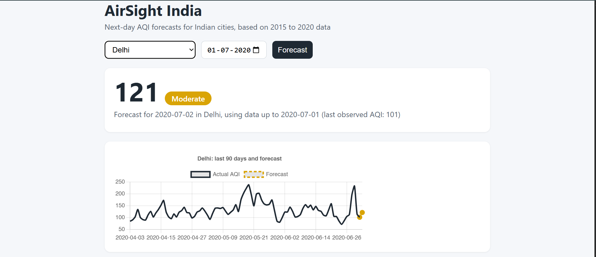
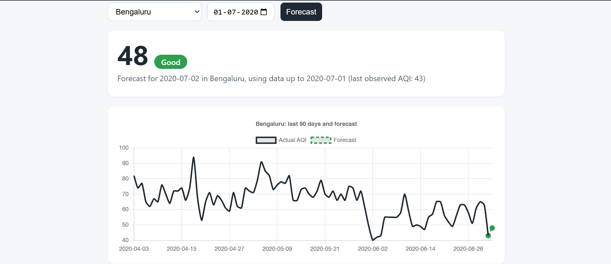
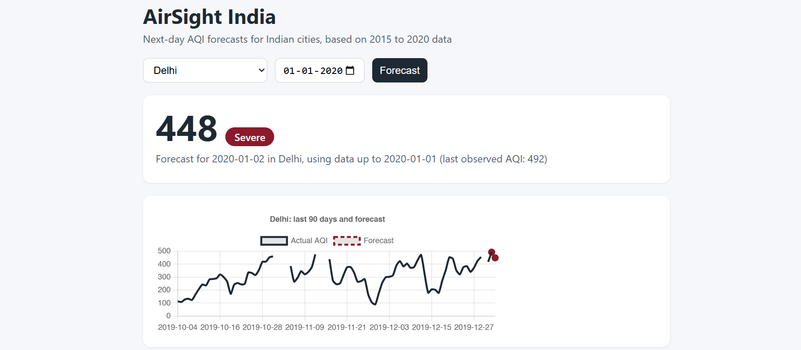

# AirSight India

Next-day air quality (AQI) forecasting for Indian cities, with an interactive Flask dashboard. The project covers data cleaning, exploratory analysis, leakage-safe feature engineering, time-based validation against a persistence baseline, and a deployed-style with local web app.

**Demo video:** https://youtu.be/4X6Qa9Fq_vs

## Screenshots





## Problem Statement

Air pollution in India varies a lot by city and season. This project explores what drives AQI and forecasts the next day's AQI value and AQI category from recent pollutant readings. The key design rule is that the model only sees information available the day before, so it is a real forecast and not a same-day calculation.

## Dataset

Air Quality Data in India (2015-2020) by Rohan Rao on Kaggle: https://www.kaggle.com/datasets/rohanrao/air-quality-data-in-india

File used: `city_day.csv` (29,531 daily records, 26 cities, 1 January 2015 to 1 July 2020, 12 pollutant columns plus AQI). The raw file is not included in this repo; download it from Kaggle.

## Approach

**Cleaning.** Each city was reindexed to a full daily calendar so every lag is a true previous-calendar-day value. Pollutant gaps were forward-filled for at most 3 days per city (no backward filling, which would use future data). AQI is the target and was never imputed. Xylene was dropped (about 61% missing). 543 AQI values above the standard 0-500 scale were set to missing, and 76% of them came from Ahmedabad.

**Ahmedabad excluded from forecasting.** Ahmedabad's CO readings are abnormal throughout the dataset (median CO 10.31 versus 1.91 for the next-highest city), and its AQI correlates more with CO (0.66) than with PM2.5 (0.28), the opposite of cities like Delhi (0.88 vs 0.30) and Lucknow (0.93 vs 0.13). Its AQI values were judged unreliable, so it is kept for exploration only. Five more cities (Aizawl, Ernakulam, Kochi, Bhopal, Shillong) were excluded for too few training observations, leaving 20 cities.

**Features.** AQI lags (1 to 3 days), previous-day values of every pollutant, 7-day rolling means of AQI and PM2.5 (shifted by one day so today's value never leaks in), month, day of week and city. Same-day pollutant readings and the AQI bucket column are not used as inputs, because they would give away the answer.

**Validation.** Time-based splits only, never random. Experiment 1 trains on 2015-2019 (18,501 rows) and tests on January to July 2020 (3,462 rows). Experiment 2 trains on 2015-2018 (12,093 rows) and tests on 2019 (6,408 rows). Every model is compared with a persistence baseline (tomorrow = today), which turned out to be a strong baseline because AQI changes slowly.

## Results

**Regression: next-day AQI (train 2015-2019, test Jan-Jul 2020, 20 cities)**

| Model | MAE | RMSE | R2 |
|---|---|---|---|
| Persistence baseline (tomorrow = today) | 18.42 | 30.64 | 0.81 |
| 7-day rolling mean | 23.58 | - | - |
| Linear Regression | 16.80 | 25.89 | 0.86 |
| Random Forest | 15.38 | 24.00 | 0.88 |
| Gradient Boosting | 15.30 | 23.81 | 0.88 |

Gradient Boosting lowers MAE by about 17% and RMSE by about 22% versus persistence. Random Forest and Gradient Boosting are effectively tied, and hyperparameter tuning (RandomizedSearchCV with time-series cross-validation) gave no improvement (MAE 15.30, RMSE 23.96), so the defaults were already near the ceiling for these features.

**Second time-based validation (train 2015-2018, test 2019, 20 cities)**

| Model | MAE |
|---|---|
| Persistence baseline | 23.13 |
| Gradient Boosting | 18.33 |

The gain over persistence is 20.7% in 2019 and about 17% in 2020, so the improvement holds across two different test periods. Absolute errors are higher in 2019 because that window covers a full year including winter pollution peaks.

**Unseen cities.** Three of the 20 cities in the 2019 test set (Chandigarh, Coimbatore, Guwahati) have no data before 2019 and were never seen in training. The model still beat persistence on them (MAE 19.04 vs 25.91, a 26.5% gain, compared with 20.1% for the 17 seen cities). This fits the model relying mainly on recent pollutant and AQI values rather than city identity. With only three cities and 594 rows, this is indicative rather than conclusive.City averages exclude AQI values above 500, so they slightly understate the most polluted cities.

**Classification: next-day AQI category (same 2020 test window)**

| Model | Macro F1 | Exact accuracy | Within 1 category |
|---|---|---|---|
| Persistence | 0.671 | 0.762 | 0.995 |
| Logistic Regression | 0.596 | - | - |
| Random Forest | 0.721 | 0.772 | 0.997 |

The macro F1 gain over persistence comes mainly from better recall on the rarer categories, at the cost of lower precision for Poor (0.54). The Severe class has only 9 test rows, so its score is unreliable. When the model is wrong, it is almost always only one category off (99.7%).

**Serving check.** To confirm the Flask app builds the same features as the training pipeline, app predictions were compared with batch predictions from the same model on 200 random test rows. The maximum and mean absolute differences were both 0.0.

## Error Analysis

Permutation importance on the tuned model shows it relies mainly on the previous day's PM2.5 (18.5), then previous-day AQI (8.3), PM10 (3.6) and the 7-day AQI mean (2.4). City has very low importance (0.4). Because these features are correlated, importance is shared between them, so the ranking shows which signals matter rather than exact effects.

In absolute terms, errors are largest in Lucknow (26.6), Delhi (24.0) and Gurugram (23.2) and smallest in Bengaluru (6.8), but this is partly a scale effect. As a percentage of mean AQI, the highest relative errors are in Amritsar (20.0%), Visakhapatnam (18.0%) and Lucknow (16.9%), and the lowest in Bengaluru (8.5%) and Jaipur (10.6%). Across cities, the model's relative error correlates 0.91 with that of the persistence baseline, so cities with jumpy AQI are harder for any forecaster. Training-set size does not explain the ranking.

The model beats persistence in 18 of 20 cities, with gains above 10% in 15 of them (largest in Brajrajnagar 27.6%, Guwahati 27.5% and Jorapokhar 26.8%). It is roughly on par in Amaravati, Thiruvananthapuram and Hyderabad, and worse in Chennai (-1.8%) and Coimbatore (-16.2%, with only 178 training rows). The pooled improvement therefore hides uneven gains by city.

By month, errors are highest in January and February (21.8 and 19.0) and about half that from April to July (10.7 to 12.2). This coincides with the winter pollution season but also with the start of the COVID-19 lockdown in late March, so the 2020 test window cannot separate seasonality from the lockdown effect.

## Key Insights from EDA

**Cities.** Averaged over each city's available record, Delhi (252), Patna (236), Gurugram (219) and Lucknow (215) have the highest AQI, followed by Talcher (171). Among the cleanest are Aizawl (35), Shillong (54) and Coimbatore (73), though Aizawl's figure comes from a very short record starting in March 2020, and city averages cover different time spans.

**Seasonality.** Average AQI peaks from November to January (210 to 213) and bottoms out in July and August (93 to 94), more than a 2x difference, consistent with winter pollution buildup and monsoon rain clearing the air. Months from August to December contain no 2020 data, and March to June averages include the lockdown period.

**Lockdown.** Comparing April to June 2019 with the same months in 2020 for the 19 cities that have both, average AQI fell in 18 of 19 cities, with a median drop of 27%. The largest drops were in Lucknow (-43%), Delhi (-41%), Amaravati (-39%) and Gurugram (-38%). This is an association over one comparison window; weather and other factors also vary between years.

**Pollutants.** PM10 and PM2.5 are the pollutants most strongly correlated with AQI (both 0.89), well ahead of NOx (0.49), NO (0.47), NO2 (0.45) and CO (0.30). This is consistent with the model's heavy reliance on yesterday's PM2.5.

**Forecastability.** AQI is persistent day to day: yesterday's value (MAE 18.42) beats a 7-day average (23.58), so the real test for any model is beating persistence, and the gains here are modest but consistent.

## Limitations

The data ends on 1 July 2020, so the app forecasts the day after each city's last record, not tomorrow's real AQI, and it uses no live data. The first test window is only about six months and overlaps the COVID-19 lockdown, which is why a second split (2019) was added. Values above 500 were removed, so the model is not trained or evaluated on extreme pollution episodes. Ahmedabad is excluded because its CO readings look unreliable. Some cities have short records, and city-level results are based on limited test rows. The Severe category has only 9 test rows. The model gives point forecasts with no uncertainty interval and uses no weather data.

## Run Locally

```
git clone https://github.com/aditiraghorte/AirSight-India.git
cd AirSight-India
pip install -r requirements.txt
python app/app.py
```

Open http://127.0.0.1:5000/ for the dashboard. The trained model (`models/aqi_bundle.joblib`) and the cleaned history (`data/processed/history.csv`) are included, so the raw dataset is only needed to rerun the notebook.

API routes: `/` (dashboard), `/cities`, `/forecasts` (latest forecast for all cities), `/predict?city=Delhi&date=2020-06-30`, `/trend?city=Delhi&end=2020-06-30&days=90`, `/health`.

## Project Structure

```
AirSight-India/
  app/
    app.py              Flask app and API
    templates/index.html  Dashboard page
  src/
    cleaning.py         Cleaning and daily reindexing
    features.py         Lag and rolling feature engineering
    predict.py          Next-day forecast used by the app
  notebooks/            Data understanding, modelling and analysis
  models/               Saved model bundle
  data/processed/       Cleaned history used by the app
  screenshots/
  requirements.txt
```

## Tech Stack

Python, Pandas, NumPy, Scikit-learn, Matplotlib, Seaborn, Flask, Chart.js

## Future Work

Add weather features (temperature, humidity, wind), pull live data from an AQI API, try sequence models, add forecast uncertainty intervals, and extend the horizon beyond one day.
